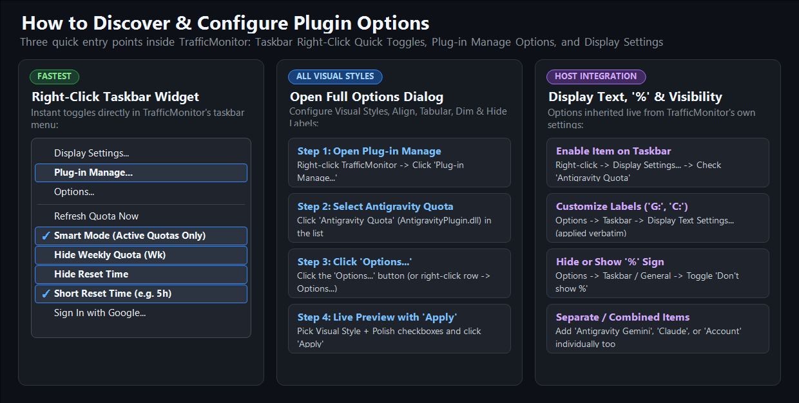
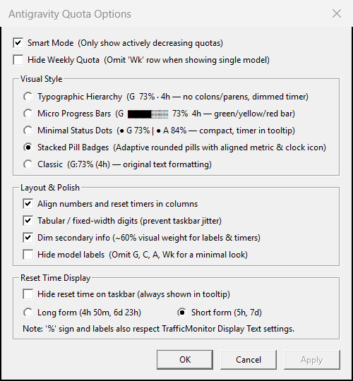
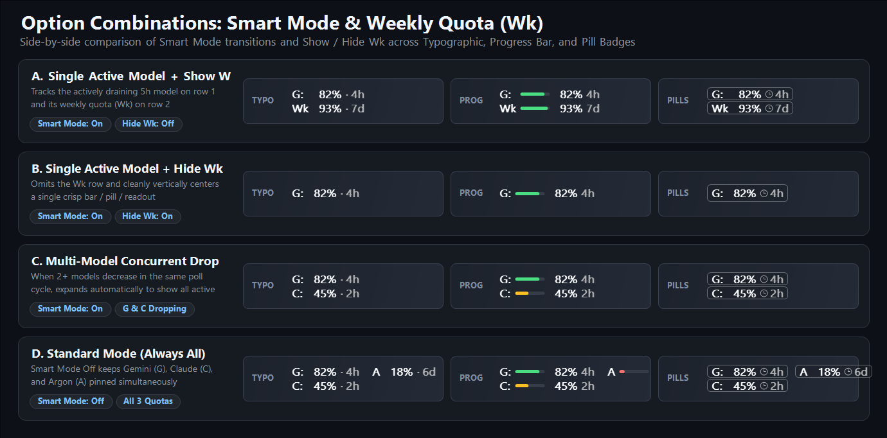
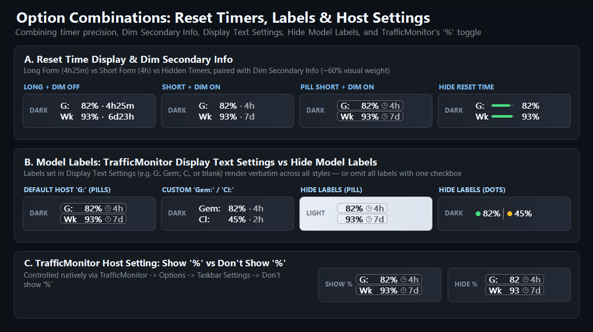

# TrafficMonitor Antigravity Plugin

An ultra-lightweight, native C++ (x86 & x64) plugin for **TrafficMonitor** on Windows that monitors Google Antigravity, Gemini, Claude, and Argon quotas directly inside your Windows taskbar.

<p align="center">
  
</p>

---

## Key Features

- **Standalone & Shared Quota Polling**: Works completely independently (no Rainmeter or AgVerse installation required) with automatic background polling every 5 minutes, OAuth token refresh, IDE credential discovery, and a **Sign In with Google...** command. When AgVerse or Rainmeter is also installed, it shares `%LOCALAPPDATA%\AntigravityQuota\vault.dat` seamlessly.
- **5 Native GDI / GDI+ Visual Styles**: Choose from *Typographic Hierarchy*, *Micro Progress Bars*, *Minimal Status Dots*, *Stacked Pill Badges*, and *Classic* — each tuned for both **Dark** and **Light** Windows 11 taskbars.
- **Health Threshold Color Schema**:
  - 🟢 **Green (`> 60%`)** — Healthy capacity remaining
  - 🟡 **Yellow (`21% – 60%`, `<= 60%` inclusive)** — Moderate usage
  - 🔴 **Red (`<= 20%` inclusive)** — Low quota warning
- **Host Display Text & Percent Integration**: Labels set in TrafficMonitor's **Display Text Settings** (such as `G:`, `C:`, or custom provider names) render **verbatim across every Visual Style**, and TrafficMonitor's native `Don't show '%'` setting is honored automatically.
- **Rich Hover Tooltip**: Always retains full breakdown of active accounts, 5-hour & weekly percentages, and exact reset countdowns even when the taskbar display is minimized.

---

## How to Discover Plugin Options

Many customization controls live inside TrafficMonitor's plugin menu and host dialogs. There are **three fast ways** to configure the plugin:

<p align="center">
  
</p>

1. **Taskbar Right-Click Quick Toggles (Fastest)**  
   Right-click the Antigravity widget directly on the taskbar to toggle **Smart Mode (Active Quotas Only)**, **Hide Weekly Quota (Wk)**, **Hide Reset Time**, **Short Reset Time (e.g. 5h)**, **Refresh Quota Now**, or **Sign In with Google...** without opening any dialog.
2. **Full Options Dialog (All Visual Styles & Polish Controls)**  
   Right-click TrafficMonitor → **Plug-in Manage...** → select **Antigravity Quota** → click **Options...** (or right-click the row → **Options...**). Use **Apply** to preview changes live on your taskbar.
3. **Host Integration Settings (Labels, Item Selection & `%`)**  
   - **Enable Taskbar Item**: Right-click → **Display Settings...** → check **Antigravity Quota** *(you can also enable `Antigravity Gemini`, `Antigravity Claude`, or `Antigravity Account` individually)*.
   - **Customize Labels**: **Options...** → **Taskbar Window Settings** → **Display Text Settings...** → edit `Antigravity Gemini` / `Antigravity Claude` (e.g., `G:`, `Gem:`, `GPT:`, or blank).
   - **Hide/Show `%`**: **Options...** → **Taskbar Window Settings** → **Don't show '%'**.

<p align="center">
  
</p>

---

## Visual Styles

All five **Visual Styles** are rendered via crisp native GDI text + anti-aliased GDI+ vector graphics and automatically adapt to Windows 11 Light and Dark taskbars.

| Visual Style | Description | Best For |
| :--- | :--- | :--- |
| **Typographic Hierarchy** *(Default)* | Clean spacing with middot (`·`) separator and optionally dimmed reset timers. | Clean daily readability with low visual clutter |
| **Micro Progress Bars** | Capsule progress bars color-coded by threshold (`> 60%` green, `21–60%` yellow, `<= 20%` red). | Instant peripheral health scanning |
| **Minimal Status Dots** | Compact horizontal strip with colored status dots; reset timers stay in the hover tooltip. | Narrow / crowded taskbars |
| **Stacked Pill Badges** | Translucent rounded pill containers with adaptive Light/Dark contrast and vector clock icons. | Modern Windows 11 / glass taskbar setups |
| **Classic** | Traditional `G:82% (4h)` text formatting with parentheses. | Users upgrading from v1.x / classic layouts |

---

## Recommended Configuration Profiles

Combine **Visual Style + Smart Mode + Weekly (`Wk`) + Timers + Labels** into ready-to-use profiles tailored to your workflow:

<p align="center">
  
</p>

| Profile | Best For | Plugin + Host Option Recipe (`X + Y + Z`) | Resulting Effect |
| :--- | :--- | :--- | :--- |
| **1. Minimal** | Tiny footprint & uncluttered taskbar | **Minimal Status Dots** + `Smart Mode: On` + `Hide model labels: On` + Host `Don't show '%': On` | Ultra-compact `● 82 \| ● 45` indicator; full details stay in tooltip |
| **2. Clean** *(Daily Driver)* | Balanced single-model tracking | **Typographic Hierarchy** + `Smart Mode: On` + `Hide Wk: Off` + `Short form` timers + `Dim secondary: On` + `Align & Tabular: On` | Clean 2-line active readout (`G 82% · 4h` / `Wk 93% · 7d`) |
| **3. Elegant** | Aesthetic Light/Dark glass taskbars | **Stacked Pill Badges** + `Smart Mode: On` + `Hide Wk: Off` + `Short form` + `Dim secondary: On` + `Align & Tabular: On` | Frosted translucent pills with aligned numbers and clock icons |
| **4. GPT / Claude Power User** | Watching multiple AI quotas together | **Micro Progress Bars** + `Smart Mode: Off` + `Short form` + Host `Display Text`: `Gem:` / `GPT:` | Side-by-side color bars alerting yellow `<= 60%` & red `<= 20%` |
| **5. Verbose** | Full telemetry without hovering | **Stacked Pill Badges** *(or Classic)* + `Smart Mode: Off` + `Long form (4h25m)` + `Dim secondary: Off` + Host `Display Text`: `G:` / `C:` | All models, exact minute timers, high-contrast labels & metrics |
| **6. Capacity Focus** | Percentage & bar health only | **Micro Progress Bars** + `Smart Mode: On` + `Hide Weekly Quota (Wk): On` + `Hide Reset Time: On` | Single vertically centered health bar (`G: ▆▆▆░░ 52%`) |

---

## Option Combinations

### Smart Mode & Weekly Quota (`Wk`) Behavior
Pairing **Smart Mode** with **Hide Weekly Quota (`Wk`)** controls how many items appear and when rows expand or vertically center:

<p align="center">
  
</p>

- **Smart Mode On + Show `Wk`**: Displays the currently draining 5-hour quota on Row 1 and its weekly (`Wk`) limit on Row 2 (`Typographic`, `Progress Bar`, or `Pill Badges`).
- **Smart Mode On + Hide `Wk`**: Drops the `Wk` row and **vertically centers** the single active quota cleanly in the taskbar slot.
- **Concurrent Multi-Model Drop**: When two or more models decrease in the same poll interval, Smart Mode automatically expands to track all dropping models simultaneously, then falls back cleanly when idle.
- **Smart Mode Off (Standard)**: Pins Gemini, Claude, and Argon together (`2+1` layout) regardless of activity.

### Reset Timers, Model Labels & Host Controls
Mixing timer formatting, visual dimming, custom host text, and label removal lets you dial in exact information density:

<p align="center">
  
</p>

- **Reset Time Display + Dim Secondary Info**:
  - *Long Form (`4h25m`, `6d23h`)* + `Dim Off` maximizes precision and contrast.
  - *Short Form (`4h`, `7d`)* + `Dim On` pushes timers into quiet background hierarchy so percentages pop first.
  - *Hide Reset Time* removes timers from the taskbar completely while preserving exact countdowns in the hover tooltip.
- **Model Labels (`Display Text Settings` + `Hide model labels`)**:
  - Custom strings configured in TrafficMonitor's **Display Text Settings** (like `G:`, `Gem:`, `Cl:`, or even blank) are displayed **verbatim in every Visual Style** — including *Stacked Pill Badges*, *Typographic*, *Progress Bars*, and *Minimal Status Dots*.
  - Checking **Hide model labels** in Plugin Options strips `G`, `C`, `A`, and `Wk` prefixes cleanly across all styles and removes column label padding.
- **Host `%` Control**: Unchecking/checking TrafficMonitor's `Don't show '%'` immediately toggles `%` suffixes across every style without changing plugin settings.

---

## Installation

1. Download the latest release from the [Releases](https://github.com/ayush1920/TrafficMonitor_Antigravity_Plugin/releases) page.
2. Select the build matching your TrafficMonitor architecture (`x64` or `x86`).
3. Copy `AntigravityPlugin.dll` to the `plugins/` directory inside your TrafficMonitor folder:
   ```text
   TrafficMonitor/
   ├── plugins/
   │   └── AntigravityPlugin.dll
   └── TrafficMonitor.exe
   ```
4. Restart TrafficMonitor.
5. Right-click TrafficMonitor → **Display Settings...** and enable **Antigravity Quota** in the Taskbar display options.

---

## Building from Source

### Prerequisites
- Visual Studio 2022 (with MSVC C++17 build tools)
- CMake 3.21 or higher

### Build Steps
Run the automated build & verification script:
```cmd
build.bat
```
Or build using CMake:
```cmd
cmake -B build/x64 -A x64 -DCMAKE_BUILD_TYPE=Release
cmake --build build/x64 --config Release
ctest --test-dir build/x64 -C Release --output-on-failure
```
