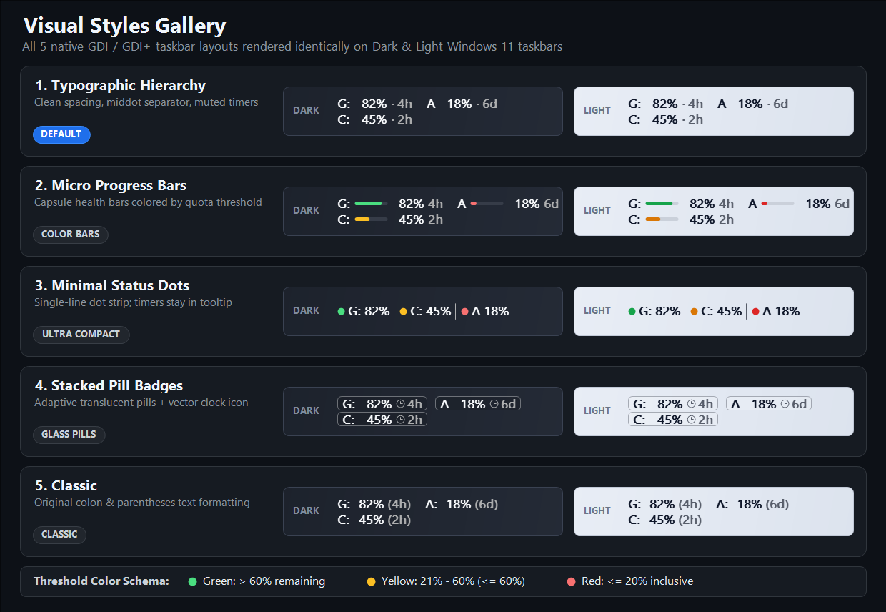

# TrafficMonitor Antigravity Plugin

<p align="center">
  <a href="https://github.com/zhongyang219/TrafficMonitor"></a>
  <a href="https://github.com/ayush1920/TrafficMonitor_Antigravity_Plugin/releases"></a>
  
  
</p>

A lightweight, native C++ (x86 & x64) plugin for **[TrafficMonitor](https://github.com/zhongyang219/TrafficMonitor)** on Windows that displays your **Google Antigravity**, **Gemini**, **Claude**, and **Argon** quotas directly inside the Windows taskbar.

---

## Visual Styles

Five crisp native GDI / GDI+ layouts that automatically adapt to **Dark** and **Light** Windows 11 taskbars, using a unified health color schema (**Green** `> 60%`, **Yellow** `21–60% (<= 60%)`, **Red** `<= 20%`):

<p align="center">
  
</p>

| Visual Style | Look & Feel | Best For |
| :--- | :--- | :--- |
| **Typographic Hierarchy** *(Default)* | Clean spacing with middot (`·`) separator and dimmed timers | Everyday low-clutter readability |
| **Micro Progress Bars** | Capsule health bars colored by `>60% / <=60% / <=20%` thresholds | Instant peripheral capacity scanning |
| **Minimal Status Dots** | Single-line dot indicator strip; timers move to hover tooltip | Narrow or crowded taskbars |
| **Stacked Pill Badges** | Adaptive translucent pills with aligned metrics & vector clock icons | Modern glass / translucent Windows 11 taskbars |
| **Classic** | Traditional `G:82% (4h)` colon & parentheses layout | Compact retro text style |

---

## Highlights

- **Standalone & Zero-Config Quota Sync**: Built-in 5-minute background WinHTTP polling, automatic OAuth refresh, IDE credential discovery, and **Sign In with Google...** right-click action (shares `%LOCALAPPDATA%\AntigravityQuota\vault.dat` if AgVerse or Rainmeter is also installed).
- **2-Row Taskbar Native**: Claims a dedicated 2-row column via TrafficMonitor API v8 (`IsDoubleLineExclusive`) for multi-row styles, while keeping *Minimal Status Dots* and single-row views compact.
- **Full Host Integration**: Respects TrafficMonitor's **Display Text Settings** (`G:`, `C:`, custom names) verbatim across all styles, honors **`Don't show '%'`** natively, and keeps complete reset countdowns in the hover tooltip.

---

## Installation (Plug & Play)

Requires **[TrafficMonitor](https://github.com/zhongyang219/TrafficMonitor)** (API v8 / v1.84+ recommended) on Windows.

1. Download **`AntigravityPlugin-x64.zip`** (or `x86` to match your TrafficMonitor build) from the **[Releases](https://github.com/ayush1920/TrafficMonitor_Antigravity_Plugin/releases)** page.
2. Extract `AntigravityPlugin.dll` into your `TrafficMonitor/plugins/` folder:
   ```text
   TrafficMonitor/
   ├── plugins/
   │   └── AntigravityPlugin.dll
   └── TrafficMonitor.exe
   ```
3. Restart **TrafficMonitor**.
4. Right-click TrafficMonitor → **Display Settings...** and enable **Antigravity Quota** on the Taskbar.

---

## Documentation

- **[Options & Discovery Guide](docs/options-guide.md)** — How to find plugin settings in TrafficMonitor, full breakdown of every option's purpose, and visual comparisons of *Smart Mode + Weekly (`Wk`)*, *Reset Timers*, *Labels*, and *Host `%`*.
- **[Recommended Configuration Profiles](docs/profiles.md)** — Ready-to-use recipes for *Minimal*, *Clean*, *Elegant*, *GPT / Claude Power User*, *Verbose*, and *Capacity Focus* setups.

---

## Building from Source

Requires **Visual Studio 2022** (MSVC C++17) and **CMake 3.21+**:

```cmd
build.bat
```

Or via CMake:

```cmd
cmake -B build/x64 -A x64 -DCMAKE_BUILD_TYPE=Release
cmake --build build/x64 --config Release
ctest --test-dir build/x64 -C Release --output-on-failure
```
