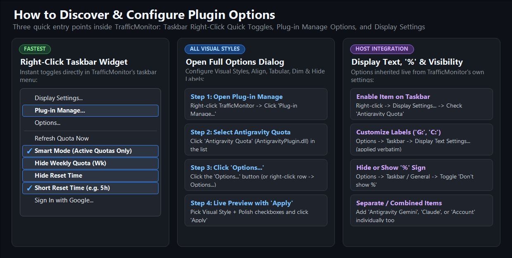
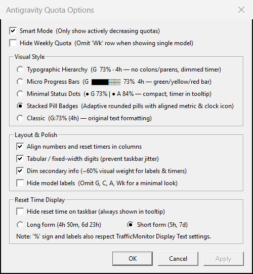
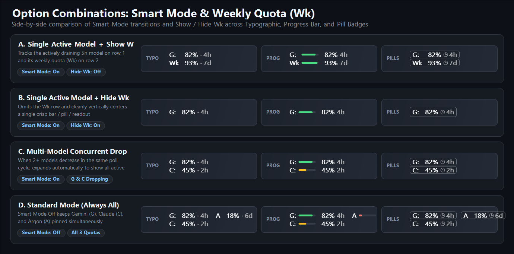
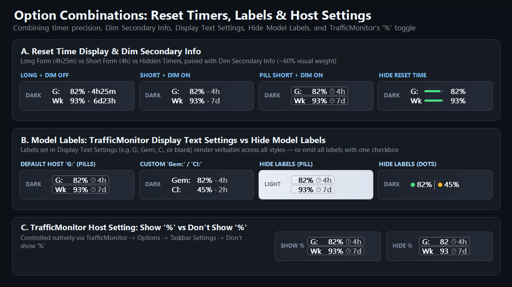

# Options & Discovery Guide

This guide explains **where to find every setting** inside [TrafficMonitor](https://github.com/zhongyang219/TrafficMonitor), **why each option exists**, and how options combine together.

---

## How to Discover Plugin Options

There are three ways to customize the Antigravity plugin inside TrafficMonitor:

  

1. **Taskbar Right-Click Quick Toggles (Fastest)**  
   Right-click the Antigravity quota widget directly on the taskbar to flip daily toggles without opening a settings window:
   - `Refresh Quota Now` — Trigger an immediate poll + vault reload
   - `Smart Mode (Active Quotas Only)` — Toggle dynamic vs always-all mode
   - `Hide Weekly Quota (Wk)` — Show or hide weekly (`Wk`) quotas
   - `Hide Reset Time` — Hide countdowns on the taskbar (always kept in tooltip)
   - `Short Reset Time (e.g. 5h)` — Switch between `4h` and `4h 25m`
   - `Sign In with Google...` — Launch browser OAuth sign-in if no IDE/vault token is active
2. **Full Options Dialog (All Visual Styles & Polish Flags)**  
   Right-click TrafficMonitor → **Plug-in Manage...** → select **Antigravity Quota** → click **Options...**. Use **Apply** to preview layout changes live on your taskbar.
3. **TrafficMonitor Host Controls**  
   - **Choose Items**: Right-click → **Display Settings...** → check **Antigravity Quota** *(combined view)*, or uncheck it and enable **`Antigravity Gemini`**, **`Antigravity Claude`**, and **`Antigravity Argon`** individually to split models across TrafficMonitor's own taskbar columns/rows *(recommended if TrafficMonitor v1.8.6 pairs **Antigravity Quota** beneath another sensor like CPU Temp on a single line)*. You can also enable **`Antigravity Account`**.
   - **Custom Labels**: **Options...** → **Taskbar Window Settings** → **Display Text Settings...** → edit `Antigravity Gemini`, `Antigravity Claude`, or `Antigravity Argon`.
   - **Percent Symbol**: **Options...** → **Taskbar Window Settings** → **Don't show '%'**.

  

---

## Option Significance Reference

### Quota Selection & Row Visibility

| Option | Default | Significance |
| :--- | :---: | :--- |
| **Smart Mode** | `Off` | **When On**: Focuses on whichever model's 5h quota is actively decreasing (showing `5h` + optional `Wk` for a single active model, expanding cleanly if 2+ models drop together, and falling back cleanly when idle). **When Off (Standard Mode)**: Keeps Gemini, Claude, and Argon permanently pinned. |
| **Hide Weekly Quota (`Wk`)** | `Off` | **When Off**: Shows `Wk` weekly limits alongside Gemini and Claude (in both single-model Smart Mode and Standard Mode `(G / Wk) \| (C / Wk) \| A`). **When On**: Omits `Wk` rows so Smart Mode vertically centers a single row and Standard Mode condenses to `(G / C) \| A`. |

  

> [!NOTE]
> Multi-entry layouts (all styles except *Minimal Status Dots*) advertise `IsDoubleLineExclusive()` via TrafficMonitor API v8, reserving a full **2-row column** on newer TrafficMonitor builds so paired taskbar items (like CPU Temperature) do not compress multiple models onto a single cramped line. On TrafficMonitor **v1.8.6** (prior to `IsDoubleLineExclusive`), or when you want compact multi-column stacking next to existing sensors, disable **Antigravity Quota** and enable **`Antigravity Gemini`**, **`Antigravity Claude`**, and **`Antigravity Argon`** individually in **Display Settings...** — all three support full CustomDraw Visual Styles and stack cleanly across TrafficMonitor's 2-row taskbar grid. Single-entry centered views and *Minimal Status Dots* stay 1-row friendly.

---

### Layout & Polish

| Option | Default | Significance |
| :--- | :---: | :--- |
| **Align Numbers & Timers in Columns** | `On` | Lines up percentages and reset timers vertically across Row 1 and Row 2 instead of ragged left-packed spacing. Essential for effortless 2-row scanning. |
| **Tabular / Fixed-Width Digits** | `On` | Draws each digit `0–9` in a fixed advance cell matching the widest digit (`'0'`–`'9'`), preventing TrafficMonitor's taskbar width from jittering as percentages drop (e.g., `100%` → `98%` → `81%`). |
| **Dim Secondary Info** | `On` | Softens model prefixes and reset countdowns to ~60–70% visual contrast (lightening dark text or dimming light text) so primary quota percentages stand out first — even inside translucent pills. |
| **Hide Model Labels** | `Off` | Strips `G`, `C`, `A`, and `Wk` text prefixes and removes their column padding for ultra-minimal setups (e.g., `● 82 \| ● 45` or label-free pill badges). |

---

### Reset Time & TrafficMonitor Host Controls

  

| Setting | Location | Significance |
| :--- | :--- | :--- |
| **Hide Reset Time** | Plugin Options / Menu | Removes countdowns from the taskbar while preserving exact timers inside the hover tooltip. Ignored visually in *Minimal Status Dots* (which always keeps timers in tooltip). |
| **Long Form vs Short Form** | Plugin Options / Menu | *Long Form* displays exact `4h 25m` / `6d 23h`; *Short Form* truncates to the largest non-zero unit (`3h 35m` → `3h`, `2h 40m` → `2h`, `0h 50m` → `50m`, `6d 23h` → `6d`) to save taskbar width cleanly. |
| **Display Text Settings** | TrafficMonitor Host | Custom labels configured in TrafficMonitor (`G:`, `C:`, `Gem:`, `GPT:`, or blank) are applied **verbatim across every Visual Style** — no colons are stripped or altered. |
| **Don't Show `'%'`** | TrafficMonitor Host | Natively hides `%` suffixes across all styles via TrafficMonitor's `OnExtenedInfo`. |
