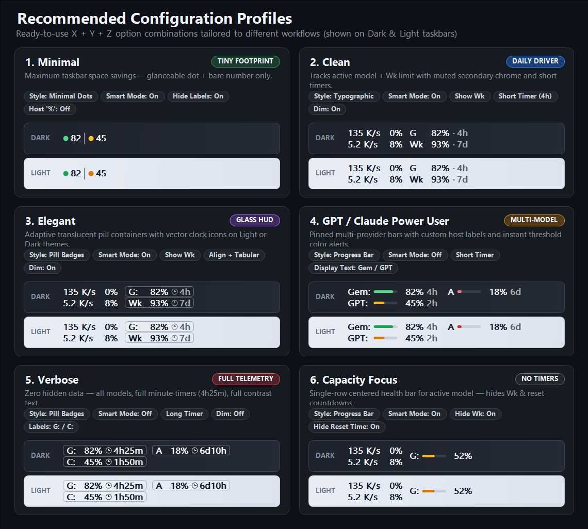

# Recommended Configuration Profiles

Pair a **Visual Style** with **Smart Mode**, **Weekly (`Wk`) visibility**, **Timer formatting**, and **Polish** flags depending on how much detail vs minimalism you want on your taskbar.

  

| Profile | Best For | Recipe (`Plugin + Host Options`) | Visual Effect |
| :--- | :--- | :--- | :--- |
| **1. Minimal** | Narrow taskbars & zero visual noise | **Minimal Status Dots** · `Smart Mode: On` · `Hide Model Labels: On` · Host `Don't show '%': On` | Ultra-compact `● 82 \| ● 45` status dots; hover for timers and `Wk` details |
| **2. Clean** *(Daily Driver)* | Balanced everyday coding focus | **Typographic Hierarchy** · `Smart Mode: On` · `Hide Wk: Off` · `Short form` timers · `Dim Secondary: On` · `Align & Tabular: On` | Clean 2-line active model + weekly readout (`G 82% · 4h` / `Wk 93% · 7d`) |
| **3. Elegant** | Light or Dark glass Windows 11 taskbars | **Stacked Pill Badges** · `Smart Mode: On` · `Hide Wk: Off` · `Short form` · `Dim Secondary: On` · `Align & Tabular: On` | Adaptive translucent pill containers with aligned metrics and vector clock icons |
| **4. GPT / Claude Power User** | Monitoring multiple AI providers side-by-side | **Micro Progress Bars** · `Smart Mode: Off` · `Hide Wk: On` · `Short form` · Host `Display Text`: `Gem:` / `GPT:` | Pinned provider bars with instant threshold alerts (`>60%` green, `<=60%` yellow, `<=20%` red) |
| **5. Verbose** | Full telemetry without hovering | **Stacked Pill Badges** *(or Classic)* · `Smart Mode: Off` · `Hide Wk: Off` *(or `On` for 5h-only)* · `Long form (4h25m)` · `Dim Secondary: Off` · Host `Display Text`: `G:` / `C:` | High-contrast multi-model view with exact minute countdowns and full weekly breakdown |
| **6. Capacity Focus** | Remaining quota bars only | **Micro Progress Bars** · `Smart Mode: On` · `Hide Wk: On` · `Hide Reset Time: On` | Single vertically centered health bar (`G: ▆▆▆░░ 52%`) |

> [!TIP]
> See the [Options & Discovery Guide](options-guide.md) for where to find each toggle in TrafficMonitor and how Smart Mode, weekly quotas, labels, and timers interact.
